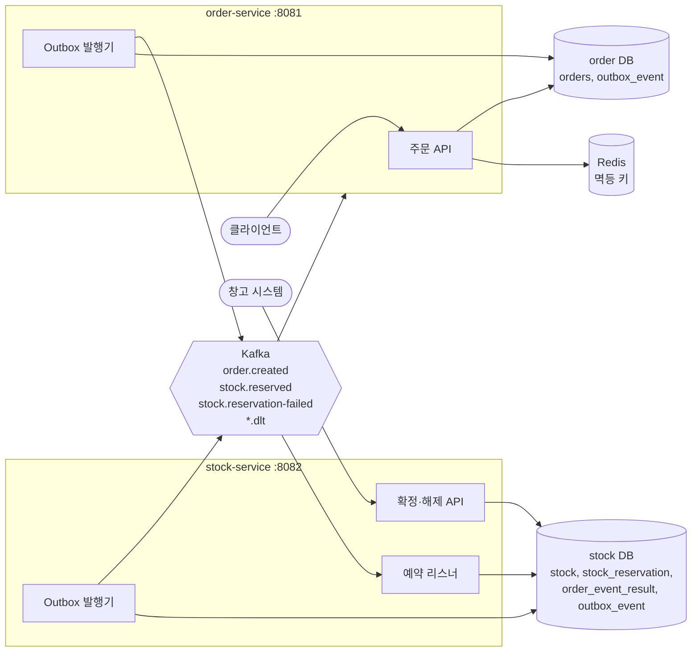
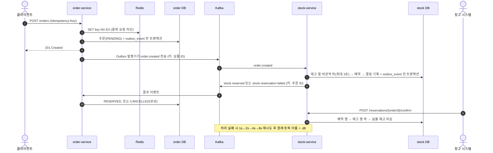

# order-stock-consistency

[](https://github.com/hbyun94/order-stock-consistency/actions/workflows/ci.yml)

한정 재고 상품에 주문이 동시에 몰리는 상황에서 **주문과 재고의 정합성**을 지키는 시스템이다. 주문 서비스와 재고 서비스가 각자의 DB를 갖고 Kafka 이벤트로 협력한다. 이때 생기는 문제(동시성, 중복 요청, 중복 소비, 발행 유실, 처리 실패)를 하나씩 재현하고, 해결책을 숫자로 검증했다.

- **기술:** Java 25, Spring Boot 4.1, JPA(Hibernate 7), Kafka 4.3(KRaft), Redis 8, PostgreSQL 18, Docker Compose, Testcontainers, GitHub Actions
- **설계 결정 49건:** 날짜, 선택지, 근거를 [docs/decisions.md](docs/decisions.md)에 기록했다
- **실험 3개:** 아래에 요약했고 상세는 [docs/experiments.md](docs/experiments.md)에 있다
- **범위 밖:** 회원/인증, 결제, 관리자 화면, 프론트엔드, Kubernetes, API 게이트웨이, 서비스 디스커버리

---

## 구성



- 서비스마다 DB가 따로 있다. 서비스 사이의 데이터는 Kafka 이벤트로만 오간다. 이벤트 클래스도 공유하지 않고 JSON 필드로 계약을 맞춘다(D-028).
- 두 서비스 모두 이벤트를 Transactional Outbox로 발행한다(D-036).

## 주문 흐름



1. **중복 요청 차단:** 같은 `Idempotency-Key`의 재요청은 새 주문을 만들지 않고 처음 응답을 그대로 돌려준다(`Idempotent-Replayed: true`).
2. **주문 저장과 이벤트 발행:** 주문과 이벤트를 한 트랜잭션으로 DB에 저장한다. 발행기가 브로커에 전달할 때까지 재시도한다.
3. **재고 예약:** 비관적 락으로 예약한다. 같은 주문이 다시 와도 기록된 결정을 보고 무시한다.
4. **보상:** 재고가 부족하면 실패 이벤트로 주문을 취소한다.
5. **예약과 확정 분리:** 출고 확정 때 예약 재고를 실물 재고에서 차감한다.
6. **재시도와 DLT:** 일시 장애는 재시도하고, 끝내 실패한 메시지는 DLT에 원문 그대로 보관한다.

---

## 실험 요약

### 실험 1: 재고 100개에 동시 주문 1,000건 — 락 방식 비교

GitHub Actions 러너에서 5회 측정한 중앙값이다. [상세](docs/experiments.md#실험-1-재고-100개에-동시-주문-1000건--락-방식별-비교)

| 방식 | 초과 판매 | 처리 시간(ms) | 비고 |
|---|---|---|---|
| 락 없음 | **795** | 699 | lost update로 재고 수치도 어긋남 |
| 낙관적 락 | 0 | 621 | 성공 1건당 충돌 약 6.6회, 재시도 소진 발생 |
| **비관적 락** | 0 | **283** | 채택(D-024) |
| Redis 분산 락 | 0 | 848 | Redis 왕복 비용 |

→ 한 행에 경합이 몰리는 한정 재고에서는 DB 안에서 줄을 세우는 비관적 락이 가장 빠르고 단순했다.

### 실험 2: 같은 이벤트를 두 번 소비하면

주문 수량 2. 정상이라면 재고 차감은 2(①②), 0(③)이어야 한다. [상세](docs/experiments.md#실험-2-같은-이벤트를-두-번-소비하면)

| 방식 | ① 중복 전달 | ② 결과 전송 실패 후 재전달 | ③ 거절 후 재고가 풀린 뒤 재전달 |
|---|---|---|---|
| 기록 없이 차감 | 차감 **4** | 차감 **4** | 예약됨 → 재고 **누수** |
| 예약 기록 UNIQUE만 | 차감 2, 재시도 소진 | 결과 이벤트 **0건**, 주문 영구 PENDING | 예약됨 → 재고 **누수** |
| **처리 결과 기록** | 차감 2 | 정상 완료 | 다시 거절 |

→ DB 제약은 두 번째 쓰기를 막을 뿐이다. "이미 처리했으면 같은 결정을 유지한다"는 멱등성은 결정 기록이 있어야 생긴다.

### 실험 3: 주문 저장 후 이벤트 발행이 실패하면

주문 20건 기준 도착한 이벤트 수다. [상세](docs/experiments.md#실험-3-주문-저장-후-이벤트-발행이-실패하면)

| 방식 | 정상 | 브로커 장애 중 | 커밋 직후 프로세스 종료 |
|---|---|---|---|
| 커밋 후 직접 전송 | 20 | 7~20 (실행마다 다름) | **0** |
| **Transactional Outbox** | 20 | 20 | 20 |

→ 직접 전송은 장애 중에 프로듀서가 20건 모두 "실패"로 보고했는데도 일부(한 번은 전부)가 도착했다. **타임아웃은 실패가 아니라 "모름"이다.** Outbox는 커밋된 이벤트를 결국 모두 발행했다.

---

## 기술별로 푼 문제

각 항목은 문제, 해결, 코드, 결정, 검증 순서로 정리했다.

### JPA / PostgreSQL

| 문제 | 해결 | 코드 | 결정 | 검증 |
|---|---|---|---|---|
| 동시 예약의 lost update와 초과 판매 | `PESSIMISTIC_WRITE`(`FOR NO KEY UPDATE`)로 재고 행을 잠근다 | [`StockRepository`](stock-service/src/main/java/io/github/hbyun94/stock/domain/StockRepository.java), [`OrderReservationService`](stock-service/src/main/java/io/github/hbyun94/stock/application/OrderReservationService.java) | D-024 | 실험 1, [`LostUpdateTest`](stock-service/src/test/java/io/github/hbyun94/stock/domain/LostUpdateTest.java) |
| 락을 쥔 트랜잭션이 느려지면 대기자가 커넥션을 붙잡고 쌓인다 | 락 대기 3초 상한(`SET LOCAL lock_timeout`), 초과 시 롤백 후 재시도 | `findByProductIdForReservation` | D-047 | [`ReservationLockTimeoutTest`](stock-service/src/test/java/io/github/hbyun94/stock/application/ReservationLockTimeoutTest.java) |
| 출고 확정이 예약 처리와 같은 행을 동시에 바꾼다 | 예약 행 → 재고 행 순서로 잠근다(교착 없음) | [`StockService`](stock-service/src/main/java/io/github/hbyun94/stock/application/StockService.java) | D-048 | [`StockConfirmConcurrencyTest`](stock-service/src/test/java/io/github/hbyun94/stock/application/StockConfirmConcurrencyTest.java): 락이 없으면 재고 60이 88이 된다 |
| 예약과 확정의 분리, 중복 확정 방지 | 주문별 예약 행(`order_id UNIQUE`)의 상태 전이(RESERVED → CONFIRMED/RELEASED) | [`StockReservation`](stock-service/src/main/java/io/github/hbyun94/stock/domain/StockReservation.java) | D-006, D-009 | [`StockReservationTest`](stock-service/src/test/java/io/github/hbyun94/stock/domain/StockReservationTest.java) |
| 여러 발행기가 같은 Outbox 행을 보내면 안 된다 | `FOR UPDATE SKIP LOCKED`로 행을 나눠 잡는다 | [`OutboxEventRepository`](order-service/src/main/java/io/github/hbyun94/order/outbox/OutboxEventRepository.java) | D-038 | [`OutboxRelayTest`](order-service/src/test/java/io/github/hbyun94/order/outbox/OutboxRelayTest.java) |
| 스키마와 엔티티 불일치 | Flyway가 스키마를 만들고, Hibernate는 `ddl-auto: validate`로 검사만 한다 | `db/migration` | D-010 | 모든 통합 테스트 |

### Kafka

| 문제 | 해결 | 코드 | 결정 | 검증 |
|---|---|---|---|---|
| 같은 상품 주문의 처리 순서 | `order.created`의 키를 상품 ID로 둔다(같은 파티션, 순서 유지) | [`OutboxOrderEvents`](order-service/src/main/java/io/github/hbyun94/order/messaging/OutboxOrderEvents.java) | D-027 | [`OrderCreatedOutboxTest`](order-service/src/test/java/io/github/hbyun94/order/messaging/OrderCreatedOutboxTest.java) |
| 같은 이벤트의 중복 소비 | 재고 쪽은 주문별 결정 기록(`order_event_result` PK), 주문 쪽은 상태 기반 멱등 | [`OrderReservationService`](stock-service/src/main/java/io/github/hbyun94/stock/application/OrderReservationService.java), [`Order`](order-service/src/main/java/io/github/hbyun94/order/domain/Order.java) | D-033, D-034 | 실험 2 |
| 커밋 후 발행 실패로 이벤트 유실 | Transactional Outbox, 500ms 폴링 발행기, 최소 한 번 발행 | [`OutboxRelay`](order-service/src/main/java/io/github/hbyun94/order/outbox/OutboxRelay.java) | D-036, D-037 | 실험 3, [`ResultEventOutageTest`](stock-service/src/test/java/io/github/hbyun94/stock/messaging/ResultEventOutageTest.java) |
| 재고 부족 시 주문 정리 | 실패 이벤트로 주문을 CANCELLED 처리(보상) | [`StockResultListener`](order-service/src/main/java/io/github/hbyun94/order/messaging/StockResultListener.java) | D-030 | [`StockResultListenerTest`](order-service/src/test/java/io/github/hbyun94/order/messaging/StockResultListenerTest.java) |
| 처리 실패 메시지가 로그만 남기고 버려진다 | 같은 자리에서 지수 백오프 재시도(순서 유지) 후 `<토픽>.dlt`. 다시 해도 같은 실패(깨진 JSON, 필수 값 누락, 없는 주문)는 즉시 DLT | [`KafkaErrorHandlingConfig`](stock-service/src/main/java/io/github/hbyun94/stock/messaging/KafkaErrorHandlingConfig.java) | D-042 ~ D-046 | [`OrderCreatedRetryDltTest`](stock-service/src/test/java/io/github/hbyun94/stock/messaging/OrderCreatedRetryDltTest.java), [`StockResultRetryDltTest`](order-service/src/test/java/io/github/hbyun94/order/messaging/StockResultRetryDltTest.java) |

### Redis

| 문제 | 해결 | 코드 | 결정 | 검증 |
|---|---|---|---|---|
| 같은 주문 요청이 두 번 들어온다(재시도, 더블 클릭) | `Idempotency-Key`를 `SET NX EX`로 선점한다. 처리 중이면 409와 `Retry-After`, 완료면 처음 응답을 그대로 돌려준다. 다른 내용으로 키를 재사용하면 422(요청 지문 SHA-256 비교) | [`IdempotencyStore`](order-service/src/main/java/io/github/hbyun94/order/idempotency/IdempotencyStore.java), [`OrderService`](order-service/src/main/java/io/github/hbyun94/order/application/OrderService.java) | D-018 ~ D-023 | [`OrderControllerTest`](order-service/src/test/java/io/github/hbyun94/order/web/OrderControllerTest.java), [`IdempotencyStoreTest`](order-service/src/test/java/io/github/hbyun94/order/idempotency/IdempotencyStoreTest.java) |
| Redis가 죽어도 중복 주문은 막아야 한다 | DB의 `UNIQUE(idempotency_key)`가 최후 방어선이다 | `orders` 테이블 | D-019, D-023 | [`OrderServiceRedisDownTest`](order-service/src/test/java/io/github/hbyun94/order/application/OrderServiceRedisDownTest.java) |
| 분산 락과 DB 락 비교 | Redisson `RLock`(락 → 트랜잭션 → 커밋 → 해제). 비교 후 채택하지 않았다 | [`RedisDistributedLockStockReservationStrategy`](stock-service/src/main/java/io/github/hbyun94/stock/application/reservation/RedisDistributedLockStockReservationStrategy.java) | D-014, D-015, D-024 | 실험 1 |

---

## 실행 방법

준비물: Docker, JDK 25. Gradle은 래퍼(`./gradlew`)가 내려받는다.

### 테스트

```bash
./gradlew build
```

Testcontainers가 PostgreSQL, Redis, Kafka를 띄워 전체 테스트를 실행한다. 실험 2와 3도 여기에 포함된다.

```bash
./gradlew :stock-service:experiment
```

실험 1(락 방식 비교, 약 1분)은 따로 실행한다. 결과는 `stock-service/build/experiment/experiment-1.md`에 저장된다. GitHub에서는 Actions 탭의 "실험 1 - 락 방식 비교" → Run workflow로 실행한다.

### 로컬에서 직접 띄워 보기

1. 환경 변수 파일을 만든다. 비밀번호는 원하는 값으로 바꾼다. `.env`는 Git에 올라가지 않는다.

```bash
cp .env.example .env
```

2. 인프라를 띄운다. Kafka(9092), Kafka UI(8080), Redis(6379), order DB(5433), stock DB(5434)가 뜬다.

```bash
docker compose up -d
```

3. 두 서비스를 각각 다른 터미널에서 띄운다. `bootRun`이 `.env`를 읽는다.

```bash
./gradlew :stock-service:bootRun
```

```bash
./gradlew :order-service:bootRun
```

4. 상품 1번의 재고 100개를 넣는다. 재고 등록 API는 범위 밖이라 SQL로 넣는다.

```bash
docker compose exec stock-db sh -c 'psql -U "$POSTGRES_USER" -d "$POSTGRES_DB" -c "INSERT INTO stock (id, product_id, on_hand, reserved) VALUES (nextval('"'"'stock_seq'"'"'), 1, 100, 0);"'
```

5. 주문한다. 응답의 `orderId`를 아래 요청에 쓴다.

```bash
curl -i -X POST localhost:8081/orders -H 'Content-Type: application/json' -H 'Idempotency-Key: demo-1' -d '{"productId": 1, "quantity": 2}'
```

같은 명령을 한 번 더 보내면 새 주문 없이 같은 응답과 `Idempotent-Replayed: true`가 온다.

6. 주문 상태를 본다. 1초 안팎이면 `PENDING`에서 `RESERVED`로 바뀐다.

```bash
curl localhost:8081/orders/{orderId}
```

7. 출고를 확정한다. 다시 확정하면 409가 오고, 본문에 현재 상태(CONFIRMED)가 담긴다.

```bash
curl -X POST localhost:8082/reservations/{orderId}/confirm
```

8. 재고보다 많이 주문하면 `CANCELLED`가 된다(보상 처리).

```bash
curl -X POST localhost:8081/orders -H 'Content-Type: application/json' -H 'Idempotency-Key: demo-2' -d '{"productId": 1, "quantity": 500}'
```

토픽, 메시지, DLT는 Kafka UI(http://localhost:8080)에서 볼 수 있다. 정리할 때는 `docker compose down`을 실행한다. 데이터까지 지우려면 `-v`를 붙인다.

API 요약:

| 메서드 | 경로 | 설명 |
|---|---|---|
| POST | `:8081/orders` | 주문. `Idempotency-Key` 헤더 필수. 201, 같은 키 재요청은 처음 응답 반환, 처리 중이면 409, 다른 내용으로 키 재사용은 422 |
| GET | `:8081/orders/{orderId}` | 주문 조회(PENDING / RESERVED / CANCELLED) |
| POST | `:8082/reservations/{orderId}/confirm` | 출고 확정. 이미 확정·해제됐으면 409, 예약이 없으면 404 |
| POST | `:8082/reservations/{orderId}/release` | 예약 해제(가용 재고 복원) |

---

## 한계와 다음 단계

알고 있지만 이번 범위에서 다루지 않은 것들이다.

- **Outbox 행 정리 없음:** 발행된 행을 지우지 않고 `published_at`만 기록한다(D-040). 운영에서는 보관 기간 뒤 삭제하는 작업이 필요하다.
- **발행 지연:** 폴링 주기 때문에 평균 수백 ms 늦게 발행된다. 지연이 중요하면 CDC(Debezium 등)를 검토할 수 있다.
- **DLT는 수동 재처리:** DLT를 읽는 소비자는 없다. 원인을 고친 뒤 원래 토픽으로 다시 보내면 된다. 소비자가 멱등이라 이미 처리된 메시지가 섞여도 안전하다(D-046).
- **출고 결과가 주문에 반영되지 않음:** 확정 API는 재고만 바꾼다. 주문을 SHIPPED로 바꾸는 이벤트는 두지 않았다(D-048).
- **중복 확정은 409:** 같은 확정 요청의 재시도를 200으로 받아 주는 멱등 처리는 하지 않았다. 호출자는 "409 + 현재 상태 CONFIRMED"를 성공으로 볼 수 있다.
- **브로커 1대, 복제 1:** 로컬과 테스트 구성이다. 운영이라면 복제 3과 `min.insync.replicas` 설정이 필요하다.
- **실험 1의 측정 환경:** 단일 JVM과 4코어에서 앱과 DB가 CPU를 나눠 쓴다. 절대 시간보다 상대 비교로 읽어야 한다. 개발용 컨테이너에서는 낙관적 락과 비관적 락의 차이가 오차 범위였다.
- **미해결 관찰:** 락 없음 경로에서 `@Version`이 없는데도 `ObjectOptimisticLockingFailureException`이 한 번 났다. 이후 71회 동안 재현되지 않았고, 원인은 확정하지 못했다.
- **실험 3 장애 시나리오의 도착 수:** `docker pause` 특성상 실행마다 달라서, 테스트는 도착 수 대신 결정적인 사실만 단정한다(D-049).

## 저장소 구조

```
order-service/     주문 API, 멱등 키, 주문 Outbox, 결과 이벤트 소비
stock-service/     재고 예약 리스너, 확정·해제 API, 재고 Outbox, 실험 1·2
docs/decisions.md  설계 결정 기록 (D-001 ~ D-049)
docs/experiments.md 실험 상세
docker-compose.yml 로컬 인프라 (Kafka KRaft, Kafka UI, Redis, PostgreSQL 2개)
.github/workflows  CI(빌드와 테스트), 실험 1 수동 실행
```
